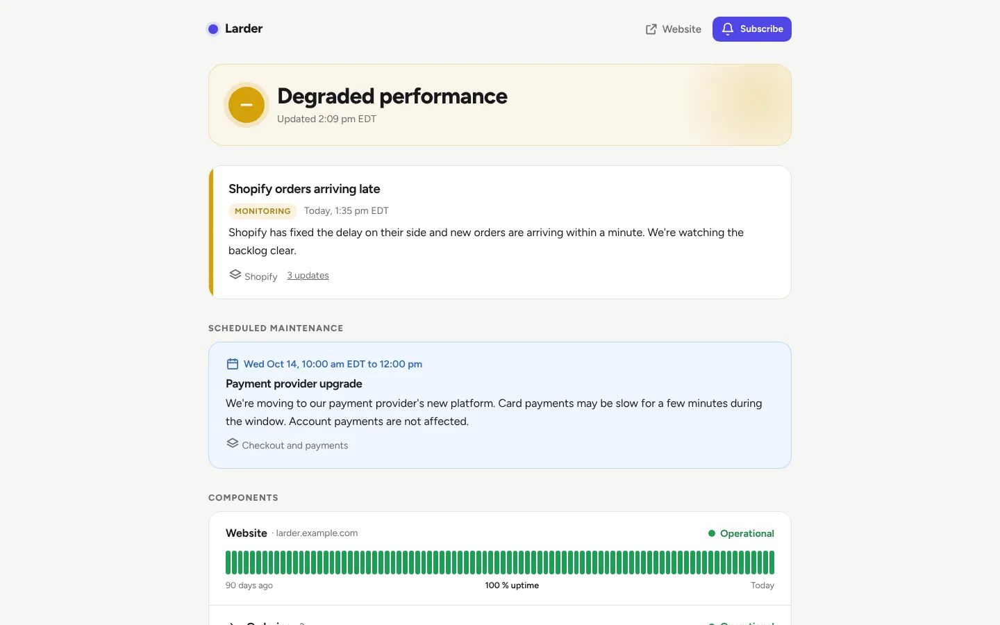
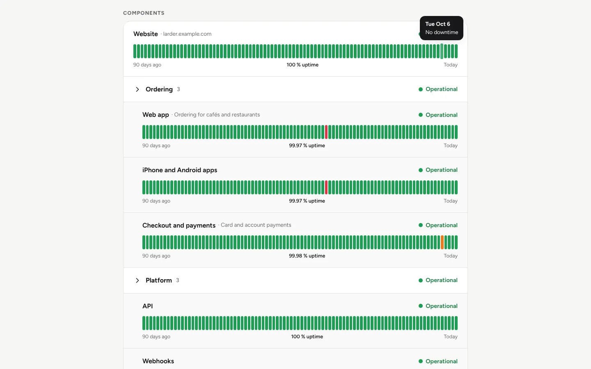
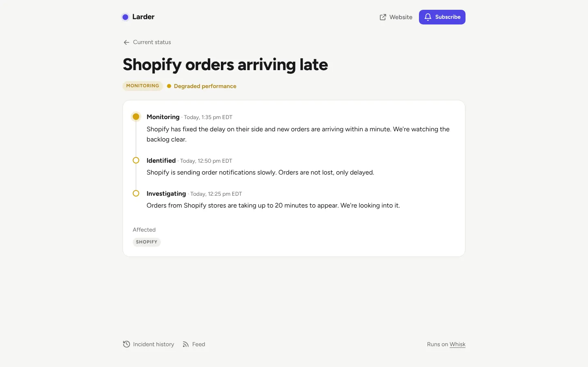
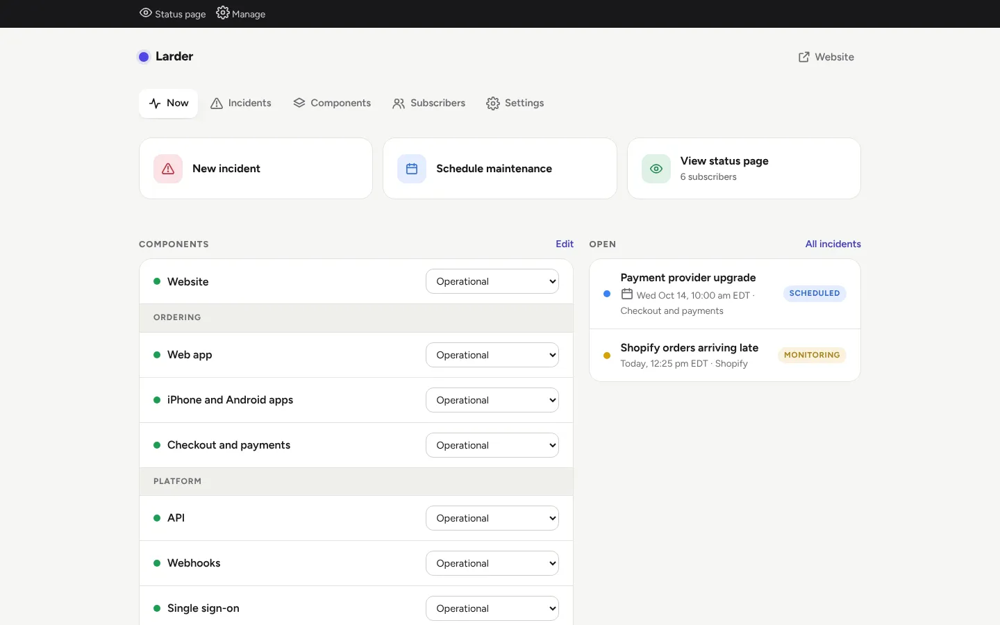
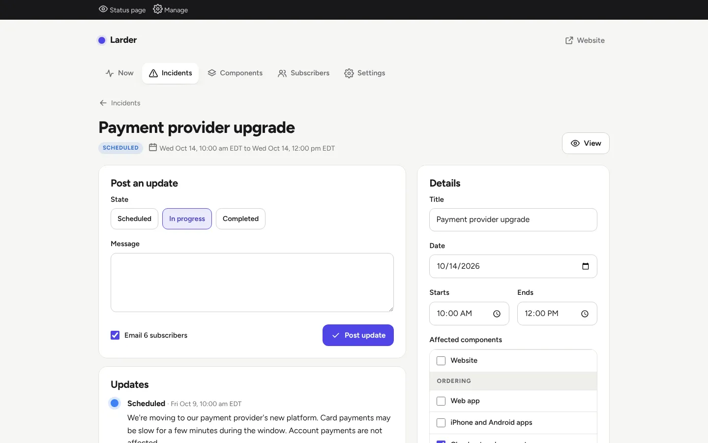
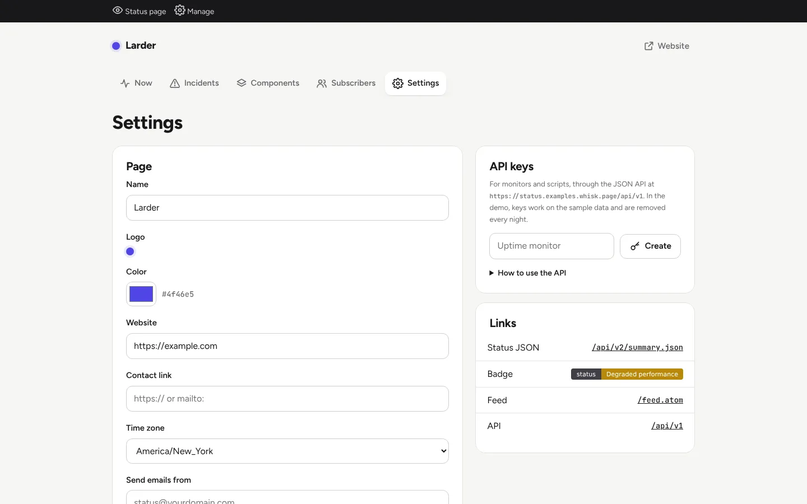
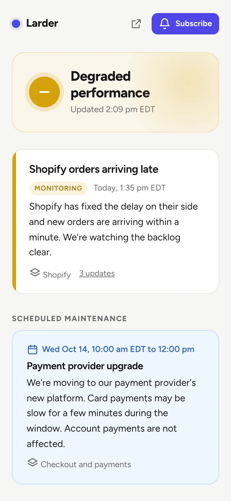
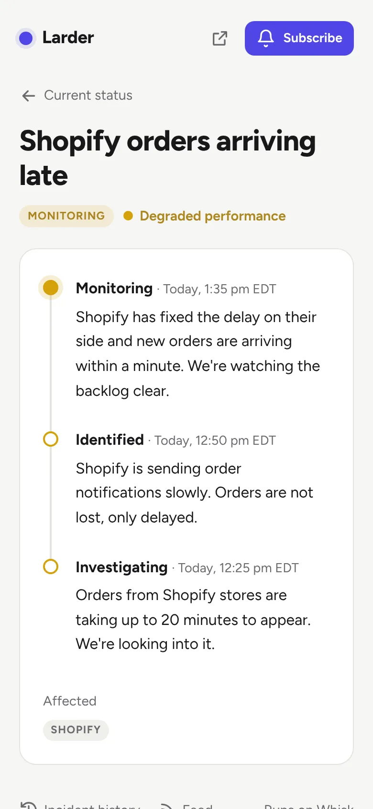

# Status page

A status page for your business: components with 90-day uptime bars, incidents with a timeline of
updates, scheduled maintenance, email subscribers, an Atom feed and an API your monitors can use.
It replaces Atlassian Statuspage or Instatus for most small businesses.



**[See it live](https://status.examples.whisk.page)**. The status page is open to everyone. Press
**Look around** to manage it as staff. It resets every night.

## Deploy your own

Paste this into Claude Code, Codex, Cursor or any coding agent:

> Read https://whisk.run/skill. Then clone https://github.com/Whisk-Hosting/status-page, deploy it to Whisk as a new app, and give me its address.

Your agent signs you up to Whisk if you're new, deploys the app, and gives you its address. It
comes with sample data so every screen has something to show.

Once it's live, ask your agent to make it yours in plain words, for example:

> Change the name to Maple Street Dental and use our logo and our blue.
>
> Replace the sample components with our website, online booking and phone line.
>
> Post a message to our Slack channel whenever an incident is opened or resolved.

Prefer the command line?

```
git clone https://github.com/Whisk-Hosting/status-page && cd status-page
whisk init --name status
whisk deploy -m "Set up the status page"
```

## What is Whisk?

[Whisk](https://whisk.run) hosts business apps built with AI coding agents. Your agent creates the
account, pushes the app, and it's live at its own address with sign-in, a database, backups,
scheduled jobs, email and security already taken care of. This app is one of the
[Whisk examples](https://whisk.run/examples): open source, MIT licensed, and yours to change.

## Screenshots

<table>
  <tr>
    <td width="33%"><br>90 days of uptime per component</td>
    <td width="33%"><br>Every incident has its own timeline</td>
    <td width="33%"><br>Staff change statuses in one place</td>
  </tr>
  <tr>
    <td><br>Post updates and email subscribers</td>
    <td><br>Your brand, API keys and feeds</td>
    <td>
      
      <br>On a phone
    </td>
  </tr>
</table>

## Features

**The page**
- A banner answers "is it up?" at a glance: All systems operational, Degraded performance,
  Partial outage, Major outage or Under maintenance.
- Open incidents, upcoming maintenance, and components in groups with 90 days of uptime (30 on a
  phone). Hover or tap a bar to see that day.
- The last two weeks of incidents, and a history that goes back month by month. Dark mode follows
  the device.

**Incidents and maintenance**
- Incidents go through Investigating, Identified, Monitoring and Resolved. Each update can change
  the status of the components it affects and email subscribers.
- Maintenance is a window that shows as upcoming, in progress, then completed, worked out from the
  times. Components in a running window show as Under maintenance.

**Uptime**
- Worked out from the history of component statuses: a major outage counts as down and a partial
  outage as 30 % down, as Statuspage counts it.

**Subscribers**
- People confirm by email and can unsubscribe from any email.
- Emails go out in the background, paced under Whisk's sending limit, and the staff timeline shows
  how many went.

**Your brand**
- Name, logo, color, website and contact links, time zone, and your own domain through Whisk.

**For machines**
- `/feed.atom`, `/badge.svg`, and `/api/v2/status.json` and `/api/v2/summary.json` in Atlassian
  Statuspage's format, so tools that read Statuspage read this.
- An API (`/api/v1`) with keys made under Manage > Settings: set a component's status, open an
  incident, post an update. This is how an uptime monitor or a deploy script plugs in.

**Staff**
- Staff are the business's Whisk team. Everyone on it can post incidents and change components.
- Owners, admins and the `status-admins` group also manage subscribers, settings and API keys. The
  rules are two lines in `src/whisk.ts`.

## API

```
curl https://<your app>/api/v1/components -H "Authorization: Bearer sp_..."

curl -X PUT https://<your app>/api/v1/components/3 -H "Authorization: Bearer sp_..." \
  -H "Content-Type: application/json" -d '{"status": "major"}'

curl -X POST https://<your app>/api/v1/incidents -H "Authorization: Bearer sp_..." \
  -H "Content-Type: application/json" \
  -d '{"title": "Checkout is down", "body": "We are looking into it.", "component_ids": [3], "status": "major"}'

curl -X POST https://<your app>/api/v1/incidents/12/updates -H "Authorization: Bearer sp_..." \
  -H "Content-Type: application/json" -d '{"state": "resolved", "body": "Fixed."}'
```

The key goes in `Authorization: Bearer <key>`, `X-Api-Key: <key>`, Basic auth with the key as the
user name, or `?token=<key>`. In the live demo, keys made under Manage > Settings work on the
sample and are removed every night.

Statuses are `operational`, `degraded`, `partial` and `major`. Incident states are
`investigating`, `identified`, `monitoring` and `resolved`. `"notify": false` posts without
emailing subscribers. Errors are `{"error": {"code", "message", "fix"}}`.

## How it's built

Hono on Node, Postgres through `postgres`, no front-end framework. Pages render on the server; a
small script adds the uptime tooltips, the bot challenge and the logo upload. Decisions are pure
functions over read-only data, and the database, email and queue are thin shells around them.

```
src/model.ts          pure: statuses, the banner, maintenance state, uptime, time zones
src/forms.ts          pure: reading staff forms and API bodies into changes
src/feeds.ts          pure: Atom, the badge, Statuspage-compatible JSON
src/sample.ts         pure: the sample page, relative to now
src/load.ts           gathers what a page needs, then works it out with model.ts
src/store.ts          one small query per function
src/notify.ts         confirmation and update emails, written down first, sent in batches
src/functions.ts      notify-subscribers and the nightly tidy (Inngest, on Whisk's queue)
src/api.ts            /api/v1
src/routes/           the public pages and the staff screens
src/views/            layout, pages, styles, icons, the browser script
src/demo.ts           the live demo only; delete it in your copy if you like
migrations/           plain SQL, run in order before each release
```

Whisk provides sign-in (`X-Whisk-*` headers), the database, storage and image resizing for the
logo, email, the queue and schedules, the bot challenge on public forms, and custom domains.

**Why there is no built-in monitoring.** A check every minute keeps the app awake all day. Point
any monitor (Uptime Kuma, Better Stack, a cron job) at the API instead.

## Run it locally

With Postgres running:

```
npm install && npm run build
DATABASE_URL=postgres://… node dist/migrate.js
DATABASE_URL=postgres://… PORT=8080 node dist/index.js
```

Outside Whisk, email is logged instead of sent. Staff screens need the `X-Whisk-*` headers, so
use `whisk dev --as you@example.com --roles owner -- node dist/index.js` to sign in.

`npm test` runs the unit tests and `npm run typecheck` checks the types.

## License

MIT
